<div align="center">

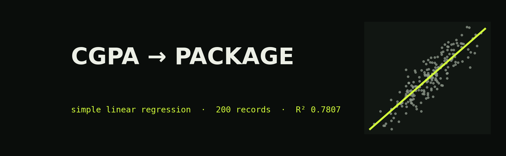

# 📈 CGPA → Package Predictor

### A simple linear regression model, built twice from scratch, judged by seven regression metrics, shipped as a live two-page web app.


**Type in a CGPA. Press predict. See your package, and exactly where you stand.**

[🚀 Live Demo](https://placement-package-predictor.onrender.com/) · [📓 Notebook](notebook/Linear_Regression_Combined.ipynb) · [📊 Metrics Analysis](#-regression-metrics-the-complete-analysis) · [🛠 Deployment Guide](DEPLOYMENT.md)

</div>

---

## 🧭 Table of Contents

1. [What this project is](#-what-this-project-is)
2. [App preview](#-app-preview)
3. [The dataset](#-the-dataset)
4. [Linear regression, explained properly](#-linear-regression-explained-properly)
5. [The two implementations](#-the-two-implementations)
6. [Training log](#-training-log)
7. [Regression metrics: the complete analysis](#-regression-metrics-the-complete-analysis)
8. [Visual analysis of the fit](#-visual-analysis-of-the-fit)
9. [How the web app works](#-how-the-web-app-works)
10. [Project structure](#-project-structure)
11. [Run it locally](#-run-it-locally)
12. [Deploy it](#-deploy-it)
13. [Limitations](#-limitations)
14. [Ideas for next steps](#-ideas-for-next-steps)

---

## 🎯 What this project is

Every placement season the same question shows up: *"With my CGPA, what package can I realistically expect?"*

This project answers it with the simplest honest tool in machine learning, **simple linear regression**: one input (CGPA), one output (package in LPA, lakhs per annum), one straight line. It then goes further than most beginner projects and asks the harder question: *how much should you trust that line?* Seven regression metrics, a baseline comparison, cross-validation and residual diagnostics answer it.

| Piece | What it does |
| --- | --- |
| **Notebook** | Trains the model two ways (scikit-learn `LinearRegression` and a hand-written `MeraLR` class) and evaluates it with all seven metrics. |
| **`model.py`** | The notebook logic as functions: same split, same estimator, same `random_state`, same seven metric formulas. |
| **`analysis.py`** | Train-vs-test scores, baseline comparison, 5-fold cross-validation and residual diagnostics. |
| **`app.py`** | The Streamlit entry point. Trains on start-up and routes between the two pages. |
| **`views.py`** | The two pages: an input page and an animated insights page with the accuracy lab. |
| **`insights.py`** / **`charts.py`** | The numbers (percentiles, peers, what-ifs, targets) and every Plotly graph. |
| **`frontend/cgpa_input/`** | A custom input component: a text box and a slider that move together in real time. |
| **`assets/style.css`** | The whole custom interface: loading sequence, count-up numbers, rings, a 200-student dot grid, metric cards. |
| **`render.yaml`** | One-file deployment config for Render. |

> The model is not a wrapper around a pickle file. The app reads `data/placement.csv` and trains with the same code as the notebook every time it starts, so what you see in the notebook is exactly what the website runs.

---

## 🖥 App preview

The app has **two pages**. You enter a CGPA on the first, press a button, and only then does the prediction appear.

### Page 1: enter your CGPA


- A big text box and a slider that **move together live**: type `8.37` and the slider glides to it instantly; drag the slider and the number updates as you drag
- `−` / `+` buttons, arrow keys (±0.01) and quick-pick chips
- Typing a value over 10 shakes the box and disables the button
- A scrolling ticker and a row of animated badges show the model's live R², MAE, RMSE and MAPE
- **Nothing is predicted until you press _Predict my package_**

### Page 2: your result and insights

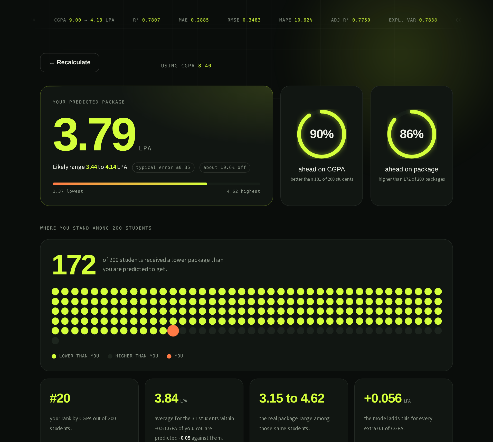

After a short animated "reading records → fitting the line → computing" sequence you get:

- Your predicted package counting up from zero, with a likely range (± the model's RMSE) and a MAPE chip
- Two animated rings: **ahead of X% of students on CGPA** and **ahead of X% on package**
- A grid of **200 dots, one per student**, that light up one by one to show how many you are ahead of, with a pulsing dot for you
- Insight cards: your CGPA rank, the average and range for students with a similar CGPA, and what each extra 0.1 CGPA is worth
- **What if** cards: the package you would get with +0.25, +0.5 and +1.0 CGPA
- **Targets**: the CGPA the model says you need for 3.0, 3.5, 4.0 and 4.5 LPA
- Six interactive graphs about the package data
- The **Model accuracy lab**: all seven metrics as animated cards plus eleven more graphs
- A **Recalculate** button at the top and bottom that returns to page 1, pre-filled with your last CGPA

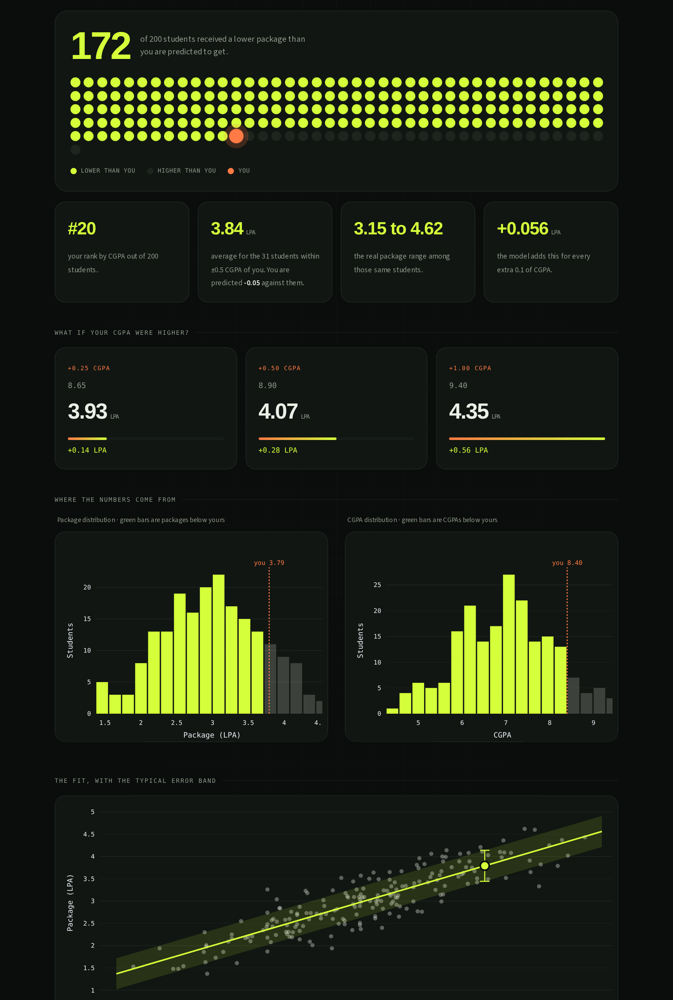

### The Model accuracy lab

A verdict banner summarises the evidence, then three tabs break it down.

**Error metrics** · MAE, MSE, RMSE and MAPE, each with its improvement over a do-nothing baseline

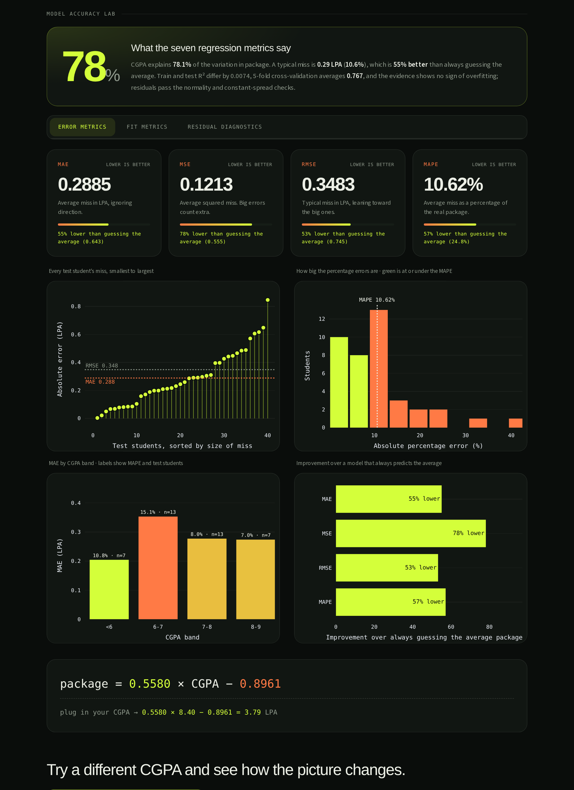

**Fit metrics** · R², adjusted R² and explained variance, with an accuracy radar, cross-validation and a train-vs-test check

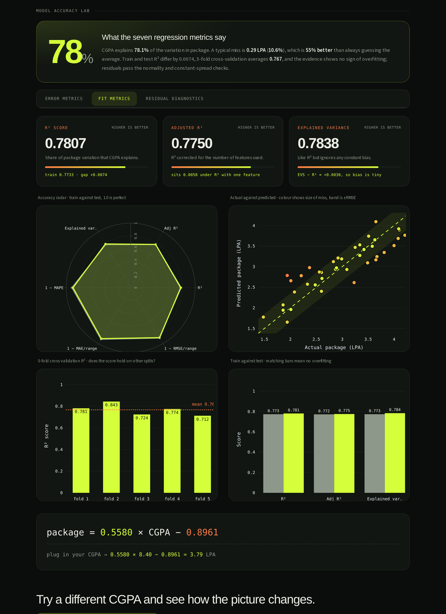

**Residual diagnostics** · bias, skewness, a normality test and a constant-spread test, each marked pass or check

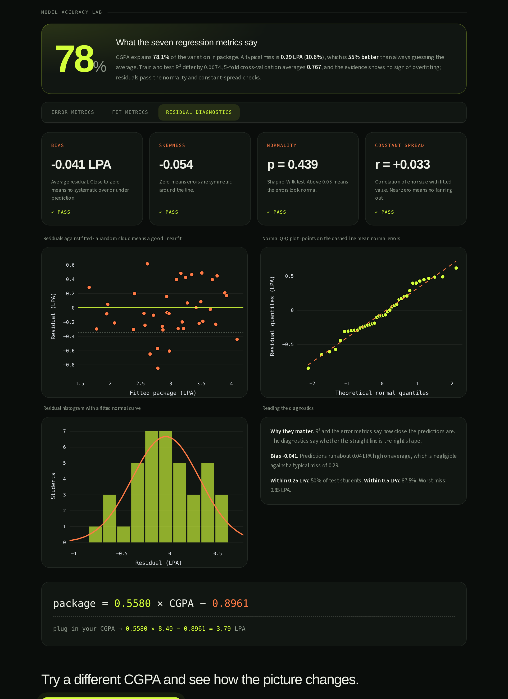

Also built in: a warning when the CGPA is outside what the model has seen, a full mobile layout, and `prefers-reduced-motion` support.

---

## 📊 The dataset

`data/placement.csv` holds **200 students** with two columns.

| Column | Meaning | Type |
| --- | --- | --- |
| `cgpa` | Cumulative grade point average (0–10 scale) | feature (X) |
| `package` | Package offered, in LPA | target (y) |

```text
>>> df.describe()

          cgpa  package
count  200.000  200.000
mean     6.991    2.996
std      1.069    0.692
min      4.260    1.370
25%      6.190    2.488
50%      6.965    2.995
75%      7.738    3.492
max      9.580    4.620
```

No missing values. Pearson correlation between CGPA and package: **0.8807**, a strong positive linear relationship, which is exactly the situation linear regression is built for.

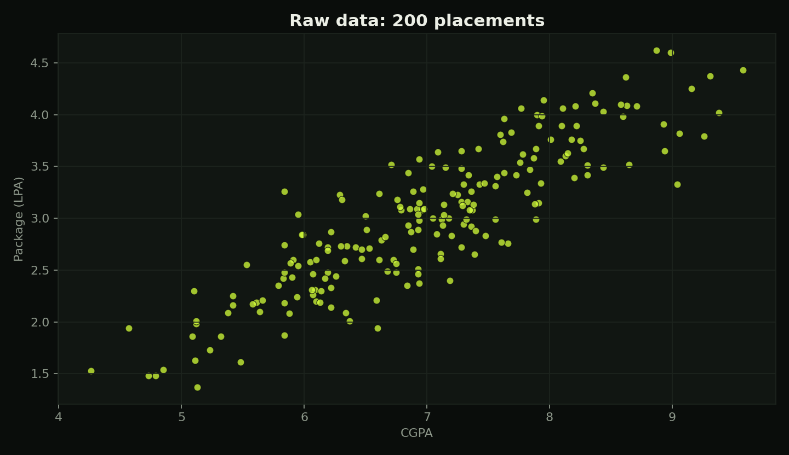

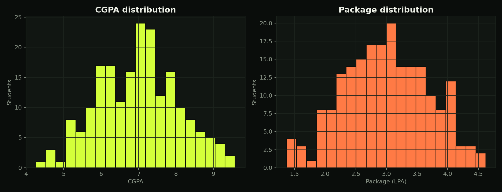

---

## 🧠 Linear regression, explained properly

### What is it?

Linear regression is a supervised learning algorithm that models the relationship between an input and a numeric output as a **straight line**. You give it examples of (input, output) pairs; it finds the line that best describes them; then you use that line to predict outputs for inputs it has never seen.

With a single input the model is called **simple linear regression**:

```
y = m·x + b
```

| Symbol | Name | Meaning in this project |
| --- | --- | --- |
| `y` | target | package (LPA) |
| `x` | feature | CGPA |
| `m` | slope / coefficient | extra LPA you gain per extra CGPA point |
| `b` | intercept | the line's value at CGPA = 0 |

### What does "best line" mean?

Infinitely many lines can be drawn through a cloud of points. The best one makes the **total prediction error as small as possible**. For each student the error (a **residual**) is the vertical distance between the real package and the line's prediction:

```
residualᵢ = yᵢ − ŷᵢ = yᵢ − (m·xᵢ + b)
```

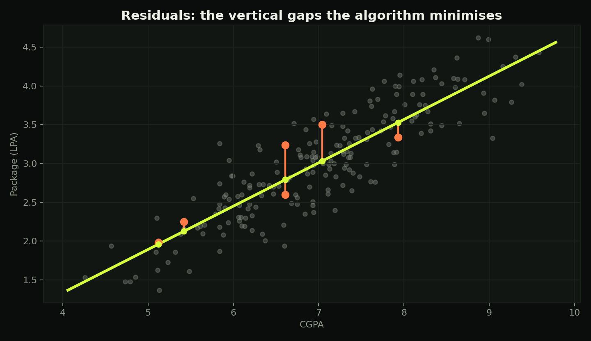

Positive and negative errors would cancel each other, so we square them and add them up. This is the **Sum of Squared Errors (SSE)**:

```
SSE = Σ (yᵢ − (m·xᵢ + b))²
```

Linear regression chooses the `m` and `b` that minimise SSE. This is called **Ordinary Least Squares (OLS)**.

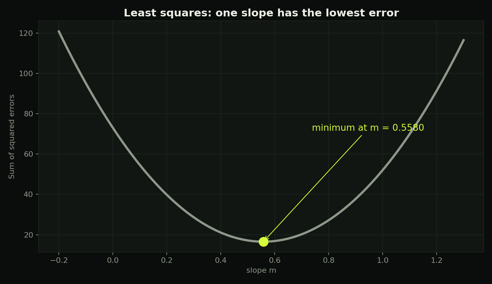

The curve above is real: it plots SSE on the 160 training rows for every slope between −0.2 and 1.3. It is a smooth bowl with a single lowest point, so there is exactly one best slope: **0.5580**.

### How is it solved?

Setting the derivatives of SSE with respect to `m` and `b` to zero gives a closed-form answer, with no iteration or guessing needed:

```
        Σ (xᵢ − x̄)(yᵢ − ȳ)
m  =  ───────────────────────
           Σ (xᵢ − x̄)²

b  =  ȳ − m·x̄
```

Worked through with this project's 160 training rows:

```text
x̄  (mean CGPA)       = 6.9899
ȳ  (mean package)    = 3.0039

numerator   Σ(x−x̄)(y−ȳ) = 101.2038
denominator Σ(x−x̄)²     = 181.3845

m = 101.2038 / 181.3845  = 0.5580
b = 3.0039 − 0.5580 × 6.9899 = −0.8961
```

So the learned model is:

```
package = 0.5580 × CGPA − 0.8961
```

- **Slope 0.5580**: every extra CGPA point is worth about **0.56 LPA** on average.
- **Intercept −0.8961**: the mathematical value at CGPA 0. No student has a CGPA of 0, so it anchors the line; it is not something to interpret.

### What are the assumptions?

Linear regression is only trustworthy when:

1. **Linearity**: the relationship is roughly a straight line
2. **Independence**: one student's package does not depend on another's
3. **Constant spread (homoscedasticity)**: errors do not fan out as CGPA changes
4. **Roughly normal residuals**: errors are centred on zero with no extreme outliers

The [residual diagnostics](#4-residual-diagnostics-is-a-straight-line-the-right-shape) further down test every one of these.

### Train / test split

Models must be judged on data they have not memorised. The 200 rows are split **80 / 20**:

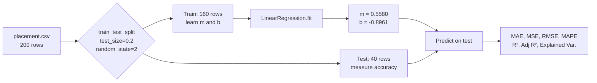

`random_state=2` freezes the shuffle so the split, and every number in this README, is reproducible.

---

## 🔬 The two implementations

The notebook builds the same model twice on purpose.

### 1. scikit-learn

```python
x=df.iloc[:,0:1]
y=df.iloc[:,-1]

lr=LinearRegression()
x_train,x_test,y_train,y_test=train_test_split(x,y,test_size=0.2,random_state=2)
lr.fit(x_train,y_train)
```

`x` is kept two-dimensional (`0:1`) because scikit-learn expects a table of features, even with one column. This is the model the website uses.

### 2. `MeraLR`: from scratch

```python
class MeraLR:
    def __init__(self):
        self.m = None
        self.b = None
    def fit(self,X_train,y_train):
      num=0
      den=0
      for i in range(X_train.shape[0]):
        num=num+((X_train[i]-X_train.mean())*(Y_train.iloc[i]-Y_train.mean()))
        den=den+((X_train[i]-X_train.mean())*(X_train[i]-X_train.mean()))
      self.m=num/den
      self.b=Y_train.mean()-(self.m*X_train.mean())
      print(self.m)
      print(self.b)
    def predict(self,X_test):
      return self.m*X_test+self.b
```

This is the OLS formula above written as a loop: `num` accumulates `Σ(x−x̄)(y−ȳ)`, `den` accumulates `Σ(x−x̄)²`, then `m = num/den` and `b = ȳ − m·x̄`.

### Do they agree?

```text
scikit-learn   m = 0.55795197342507    b = -0.89611192224291
MeraLR         m = 0.55795197342507    b = -0.89611192224291

np.allclose(lr.predict(x_test), mlr.predict(X_test))  →  True
```

They match to floating-point precision. Both are the same mathematics; scikit-learn solves it with optimised linear algebra.

---

## 🪵 Training log

Every number below comes from an actual run of the notebook and `model.py`, laid out as a log:

```text
$ jupyter nbconvert --to notebook --execute Linear_Regression_Combined.ipynb

[01] load      placement.csv ............ 200 rows × 2 cols
[02] split     train_test_split ......... 160 train | 40 test  (random_state=2)
[03] fit       LinearRegression() ....... done
[04] coef      m = [0.55795197]
[05] intercept b = -0.8961119222429144
[06] manual    MeraLR.fit() ............. m = 0.5579519734250721
                                          b = -0.8961119222429152
[07] predict   cgpa=8.58 ................ 3.8911 LPA   (actual 4.10)
[08] metrics   MAE   = 0.2884710931878175
               MSE   = 0.12129235313495527
               RMSE  = 0.34827051717731616
               MAPE  = 0.1062335673332732
               R²    = 0.780730147510384
               EVS   = 0.783770024363162
               AdjR² = 0.7749598882343415
[09] parity    sklearn vs MeraLR ........ True
```

A peek at the first eight students in the test set:

```text
 cgpa  actual  predicted  error
 8.58    4.10       3.89   0.21
 7.15    3.49       3.09   0.40
 5.88    2.08       2.38  -0.30
 6.22    2.33       2.57  -0.24
 4.57    1.94       1.65   0.29
 4.79    1.48       1.78  -0.30
 5.32    1.86       2.07  -0.21
 6.86    3.09       2.93   0.16
```

---

## 📐 Regression metrics: the complete analysis

The seven metrics come from `Regression_Metrics.ipynb` and are merged into the combined notebook, `model.py` and the website. They use the same split, the same model and the same formulas, so every value matches the original notebook to the last digit.

> In the original metrics file the RMSE cell was missing a closing bracket. It is fixed in the combined notebook; the formula is unchanged.

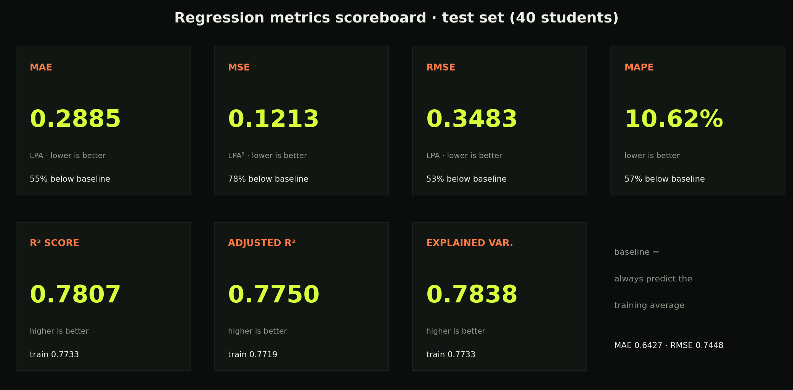

### The scoreboard

| # | Metric | Test | Train | Baseline* | Direction | Verdict |
| --- | --- | --- | --- | --- | --- | --- |
| 1 | **MAE** | **0.2885** LPA | 0.2530 | 0.6427 | lower is better | 55% better than baseline |
| 2 | **MSE** | **0.1213** LPA² | 0.1035 | 0.5547 | lower is better | 78% better than baseline |
| 3 | **RMSE** | **0.3483** LPA | 0.3216 | 0.7448 | lower is better | 53% better than baseline |
| 4 | **MAPE** | **10.62%** | 8.87% | 24.81% | lower is better | 57% better than baseline |
| 5 | **R² score** | **0.7807** | 0.7733 | −0.0028 | higher is better | explains 78% of variance |
| 6 | **Adjusted R²** | **0.7750** | 0.7719 | −0.0292 | higher is better | barely below R² |
| 7 | **Explained variance** | **0.7838** | 0.7733 | 0.0000 | higher is better | barely above R² |

<sub>*Baseline = a model that always predicts the training-set average package. It is the score you get by learning nothing.</sub>

### 1. Error metrics: how far off are the predictions?

#### MAE: Mean Absolute Error

```
MAE = (1/n) · Σ |yᵢ − ŷᵢ|
```

The average size of a miss, in the same unit as the target. **0.2885 LPA** means a typical prediction is about **₹29,000 a year** away from the truth. It treats every miss equally, so it is the easiest metric to explain.

#### MSE: Mean Squared Error

```
MSE = (1/n) · Σ (yᵢ − ŷᵢ)²
```

The average of the squared misses, in LPA². Squaring punishes big errors disproportionately: a miss of 0.8 counts sixteen times as much as a miss of 0.2. **0.1213** is hard to read directly, but it is the quantity OLS actually minimises, and it is the stepping stone to RMSE.

#### RMSE: Root Mean Squared Error

```
RMSE = √MSE
```

MSE brought back into LPA. **0.3483 LPA** is the typical miss, weighted toward large errors. RMSE is always at least as large as MAE; the gap between them (0.3483 vs 0.2885) tells you how uneven the errors are. A small gap means misses are fairly uniform; a large gap means a few big misses dominate.

#### MAPE: Mean Absolute Percentage Error

```
MAPE = (1/n) · Σ |yᵢ − ŷᵢ| / |yᵢ|
```

The average miss as a **percentage of the real package**: **10.62%**. It is scale-free, which makes it intuitive ("off by about a tenth"), but it punishes misses on small packages more heavily than on large ones, so it reads worse for low packages than the MAE suggests.

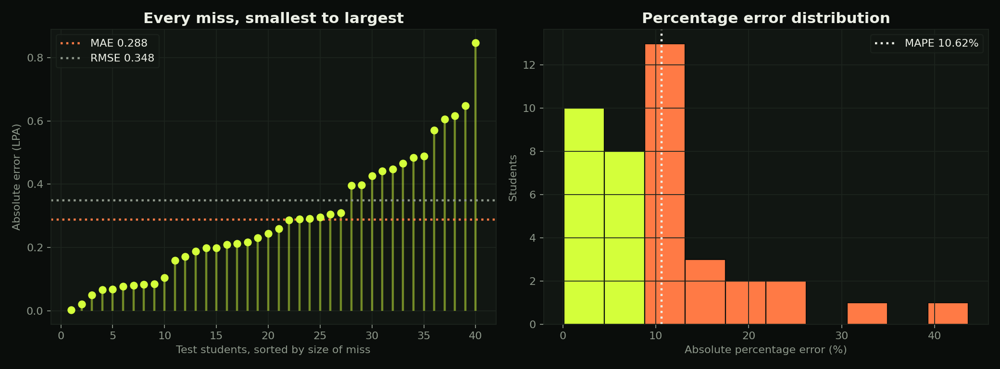

The left chart shows all 40 test misses sorted. Half sit under 0.25 LPA and only a handful climb above 0.5. The right chart shows the percentage errors: most students are within about 10%, with a thin tail of larger misses.

```text
within 0.25 LPA of the truth ... 50.0% of test students
within 0.50 LPA of the truth ... 87.5% of test students
worst single miss ............... 0.85 LPA
```

#### Does the model actually beat doing nothing?

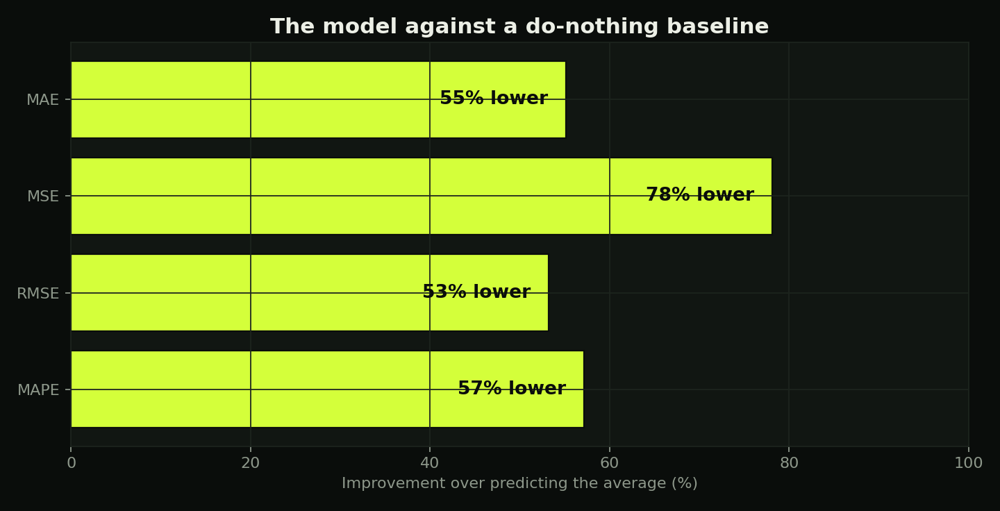

Always predicting the average package gives an MAE of 0.6427. The regression line cuts that to 0.2885, a **55% reduction**, with MSE down **78%**, RMSE down **53%** and MAPE down **57%**. CGPA carries real signal.

### 2. Fit metrics: how much of the story does the model explain?

#### R² score (coefficient of determination)

```
R² = 1 − SSE / SST = 1 − Σ(y − ŷ)² / Σ(y − ȳ)²
```

The share of the variation in package that CGPA explains. **0.7807** means **78.1%**. A score of 1 is perfect; 0 means no better than the average; negative means worse than the average. This is the headline "accuracy" number for a regression model.

#### Adjusted R²

```
Adj R² = 1 − (1 − R²) · (n − 1) / (n − p − 1)
```

R² can only go up when you add features, even useless ones. Adjusted R² subtracts a penalty for each extra feature (`p`). With one feature and 40 test rows the penalty is small: **0.7750 against 0.7807**. It becomes important the moment the model grows to multiple features.

#### Explained variance score

```
EVS = 1 − Var(y − ŷ) / Var(y)
```

Like R² but it ignores any constant offset in the predictions. **0.7838** against R² of **0.7807**: the gap of **+0.0030** exists only because the model has a tiny systematic bias (it over-predicts by about 0.04 LPA on average). When EVS and R² are nearly identical, bias is not a problem.

#### Do the three agree?

```text
R²            0.7807
Adj R²        0.7750   ← slightly lower: the feature-count penalty
EVS           0.7838   ← slightly higher: ignores the tiny bias
```

All three tell the same story within 0.009, which is what a healthy single-feature model looks like.

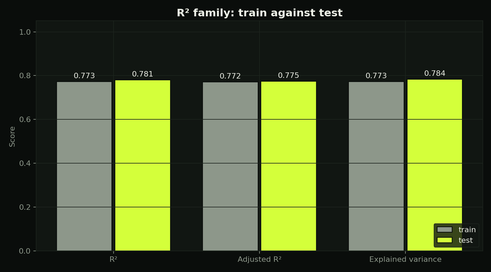

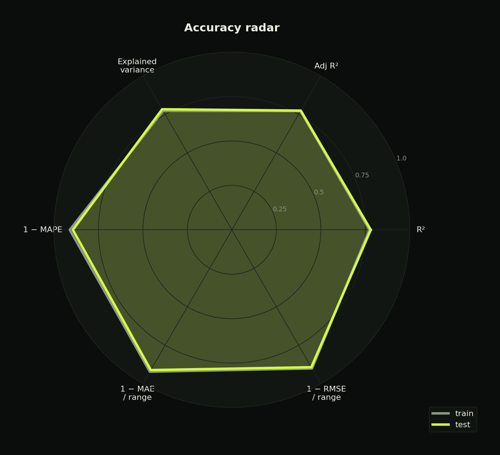

The radar collapses the metrics onto a common 0 to 1 scale (error metrics become `1 − MAPE`, `1 − MAE/range` and `1 − RMSE/range`). The train and test shapes sit almost on top of each other.

### 3. Does the score hold up? Overfitting and cross-validation

A single 80/20 split can flatter or punish a model by luck. Two checks guard against that.

**Train vs test.** Train R² is 0.7733 and test R² is 0.7807, a gap of only **0.0074**, and the test score is slightly *higher*. An overfit model shows the opposite: great train score, poor test score. There is no sign of overfitting, which is expected for a model with two parameters and 160 rows.

**5-fold cross-validation.** The data is split five different ways and the model is scored on each held-out fold:

| Fold | 1 | 2 | 3 | 4 | 5 | **Mean** | Std |
| --- | --- | --- | --- | --- | --- | --- | --- |
| R² | 0.7807 | 0.8429 | 0.7236 | 0.7741 | 0.7118 | **0.7666** | 0.0468 |

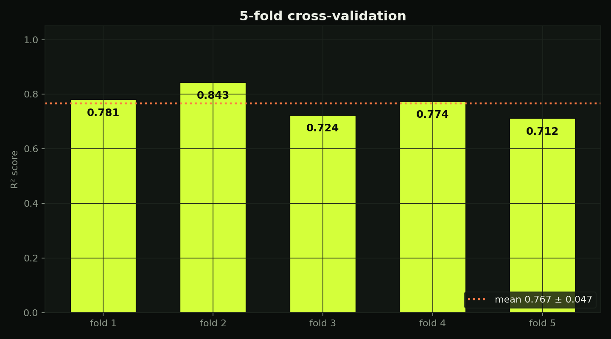

The folds range from 0.71 to 0.84. The honest reading is that the model's true R² is around **0.77**, and the 0.7807 from the single split is slightly on the lucky side. Both agree that CGPA explains roughly three quarters of the variation.

### 4. Residual diagnostics: is a straight line the right shape?

Good headline metrics can hide a badly shaped model. The residuals reveal it.

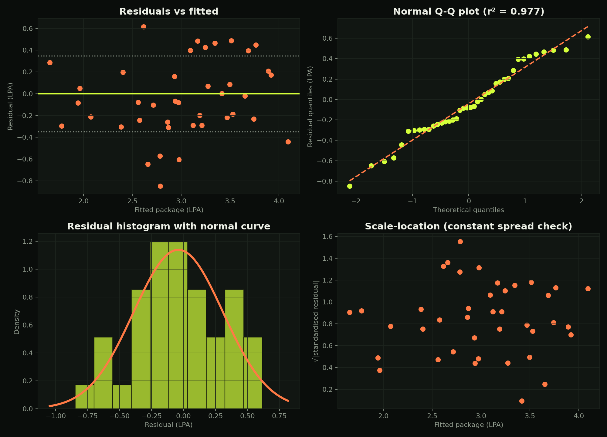

| Check | Result | Passes when | Verdict |
| --- | --- | --- | --- |
| **Bias** (mean residual) | −0.041 LPA | close to 0 | ✅ negligible |
| **Skewness** | −0.054 | near 0 | ✅ symmetric |
| **Excess kurtosis** | −0.552 | near 0 | ✅ light tails, no wild outliers |
| **Normality** (Shapiro-Wilk) | p = 0.439 | p > 0.05 | ✅ errors look normal |
| **Q-Q plot fit** | r² = 0.977 | close to 1 | ✅ points hug the line |
| **Constant spread** (corr of \|residual\| with fitted) | r = +0.033 | near 0 | ✅ no fanning out |

How to read the four panels:

- **Residuals vs fitted** (top left) is a random cloud around zero with no curve and no funnel: the relationship really is linear and the spread is constant.
- **Q-Q plot** (top right) follows the diagonal: errors are normally distributed, so the ± error band is trustworthy.
- **Histogram** (bottom left) is bell-shaped around zero.
- **Scale-location** (bottom right) shows no upward trend: errors are no bigger for high packages than for low ones.

All four assumptions of linear regression hold up.

### 5. Where is the model strongest and weakest?

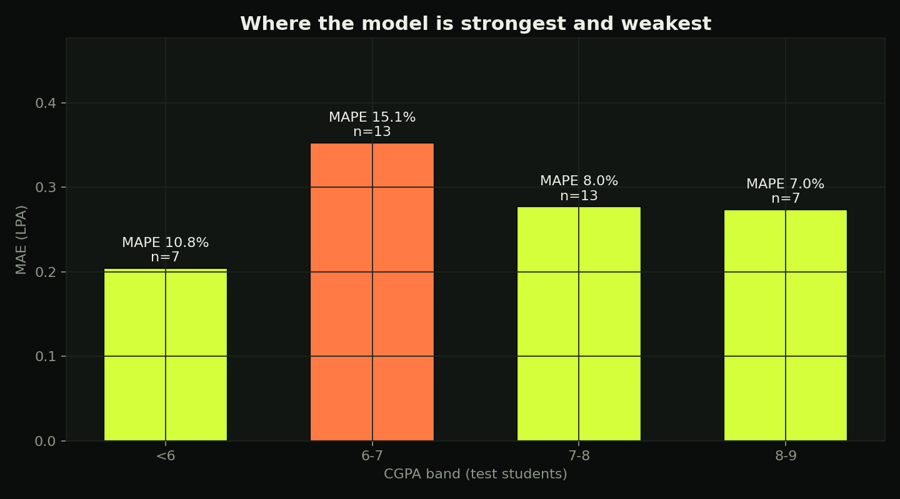

| CGPA band | Test students | MAE | MAPE |
| --- | --- | --- | --- |
| below 6 | 7 | 0.204 | 10.8% |
| 6 to 7 | 13 | **0.353** | **15.1%** |
| 7 to 8 | 13 | 0.277 | 8.0% |
| 8 to 9 | 7 | 0.274 | **7.0%** |
| 9 and up | 0 | n/a | n/a |

- The **6 to 7 band is the weakest** (13 test students): CGPA alone predicts packages least precisely here. With only 7 to 13 students per band, treat the band-level numbers as indicative, not exact.
- The **7 to 9 range is the most reliable in percentage terms** (7 to 8% error).
- The **9 and up band has no test students**, so the model's behaviour there is untested. Predictions for very high CGPAs are extrapolation.

### 6. Putting it all together

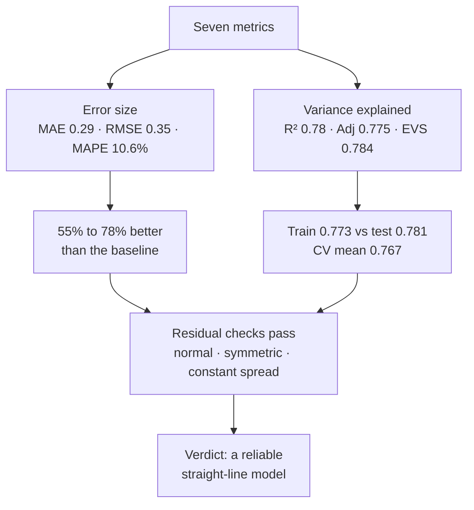

**Verdict.** This is a well-behaved model. It explains about 78% of package variation, misses by roughly 0.29 LPA (10.6%), beats the do-nothing baseline by more than half on every error metric, does not overfit, and passes every residual diagnostic.

**What limits it.** The remaining ~22% is not noise in the model; it is information CGPA does not contain: skills, projects, internships, interview performance, company, role and branch. No amount of tuning a one-feature linear model will remove it. The only way to push R² higher is to add features.

**How to use the number.** Treat a prediction as the *average outcome for students with that CGPA*, with a typical error of ±0.35 LPA (the band drawn on the website's charts), not as a promise about one person.

### How the metrics appear in the website

| Where | What you see |
| --- | --- |
| Scrolling ticker (both pages) | R², MAE, RMSE, MAPE, Adj R² and Explained Variance, live from the model |
| Input page | Four count-up badges: R², MAE, RMSE, MAPE |
| Result hero | A likely range of ± RMSE and a "% off" chip from MAPE |
| Accuracy lab, Error metrics tab | MAE, MSE, RMSE, MAPE cards with baseline comparison, per-student misses, MAPE histogram, error by CGPA band, improvement-over-baseline chart |
| Accuracy lab, Fit metrics tab | R², Adj R², Explained Variance cards, accuracy radar, actual vs predicted, 5-fold CV, train vs test |
| Accuracy lab, Residual diagnostics tab | Bias, skewness, normality and constant-spread cards with pass marks, residual vs fitted, Q-Q plot, residual histogram |

---

## 🔍 Visual analysis of the fit

### The fit

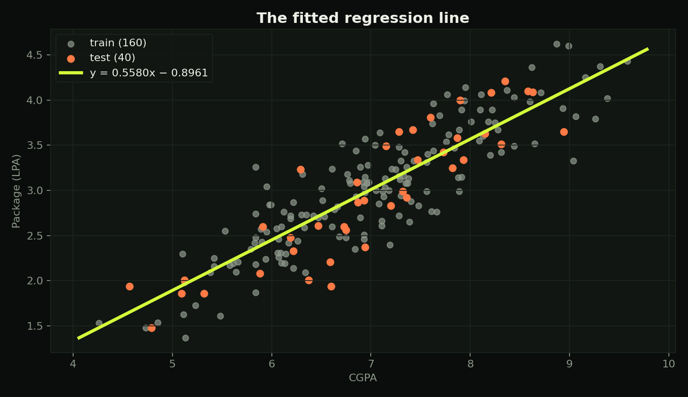

Grey points trained the model, orange points are the unseen test students, and the green line is the model. The test points hug the line as tightly as the training points do.

### Actual vs predicted

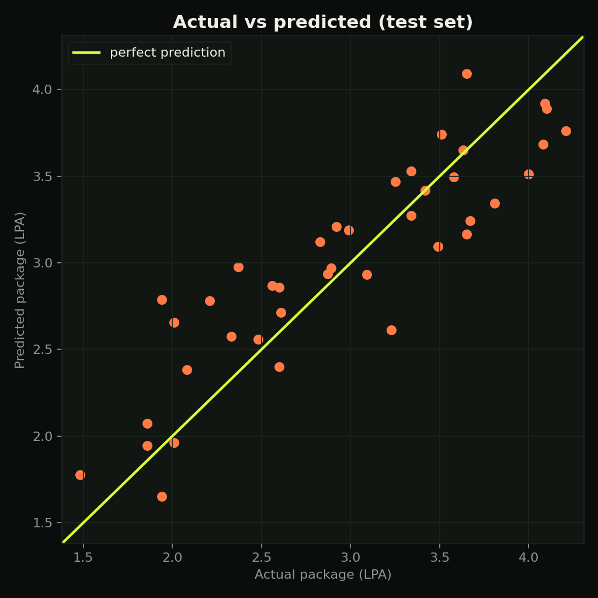

If predictions were perfect every dot would sit on the green diagonal. They scatter evenly on both sides with no systematic lean.

### Prediction ladder

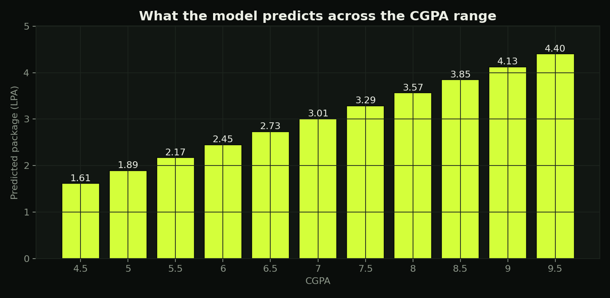

| CGPA | Predicted package |
| --- | --- |
| 4.5 | 1.61 LPA |
| 5.0 | 1.89 LPA |
| 5.5 | 2.17 LPA |
| 6.0 | 2.45 LPA |
| 6.5 | 2.73 LPA |
| 7.0 | 3.01 LPA |
| 7.5 | 3.29 LPA |
| 8.0 | 3.57 LPA |
| 8.5 | 3.85 LPA |
| 9.0 | 4.13 LPA |
| 9.5 | 4.40 LPA |

---

## ⚙️ How the web app works

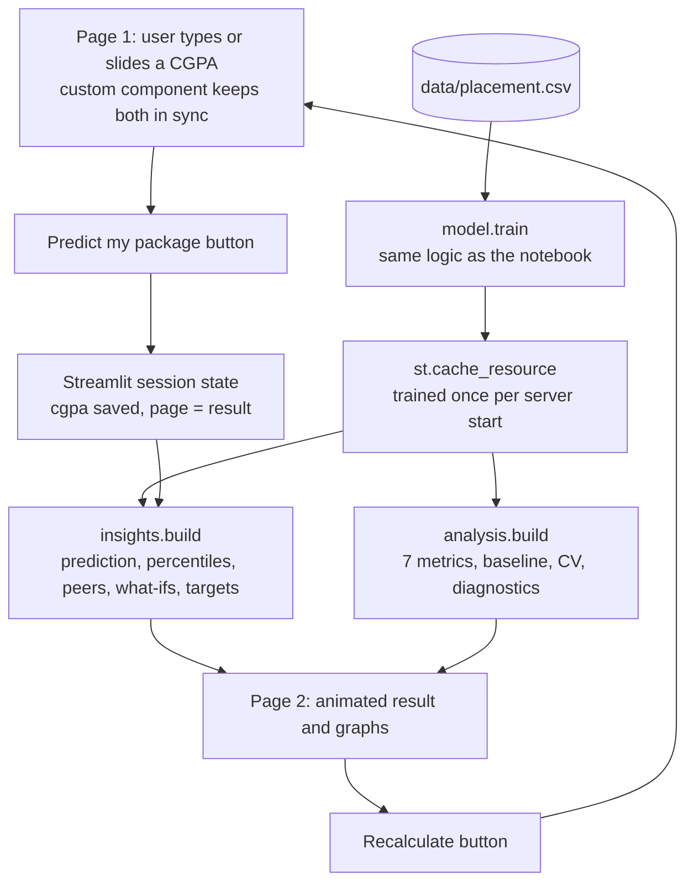

Design notes:

- **Two-page flow with session state.** The CGPA lives in `st.session_state`; pressing predict flips the page, pressing recalculate flips it back with the old value pre-filled.
- **A real-time input component.** Streamlit's built-in number box only reports a value after Enter or blur, so the input is a small custom component (plain HTML and JavaScript, no build step) that talks to Streamlit through the component `postMessage` protocol. It only sends the CGPA when the user presses predict.
- **Trains on start, caches the result.** No stale pickle files, no version mismatches between local and server.
- **Same split, same estimator.** `test_size=0.2`, `random_state=2`, `LinearRegression()`: unchanged from the notebook.
- **Pure CSS animation.** The loading sequence, count-up numbers, rings drawing themselves, dots lighting up and cards sliding in are all CSS. Numbers count up using registered `@property` integers and a custom `@counter-style`. Below-the-fold sections reveal as you scroll in browsers that support scroll-driven animations.
- **Accessible.** Animated numbers carry `aria-label`s, and `prefers-reduced-motion` switches animations off.
- **Honest output.** A prediction below zero is shown as 0.00, and CGPAs outside the training range trigger a visible extrapolation warning.

---

## 🗂 Project structure

```text
placement-predictor/
├── app.py                         entry point and page routing
├── views.py                       input page, insights page, accuracy lab
├── insights.py                    percentiles, peers, what-ifs, targets
├── analysis.py                    baseline, cross-validation, diagnostics
├── charts.py                      Plotly graphs
├── model.py                       training, prediction, seven metrics
├── requirements.txt               pinned dependencies
├── render.yaml                    Render deployment blueprint
├── DEPLOYMENT.md                  GitHub + Render walkthrough
├── README.md
├── .gitignore
├── .streamlit/
│   └── config.toml                theme and server settings
├── frontend/
│   └── cgpa_input/
│       └── index.html             live text-and-slider input component
├── assets/
│   ├── style.css                  the whole custom interface
│   ├── banner.png
│   ├── app_*.png                  website previews
│   └── *.png                      README graphs
├── data/
│   └── placement.csv              200 student records
├── notebook/
│   ├── Linear_Regression_Combined.ipynb
│   └── placement.csv
└── scripts/
    └── generate_plots.py          regenerates every README graph
```

---

## 💻 Run it locally

```bash
git clone https://github.com/vanshjagetia368/Package-Predictor.git
cd Package-Predictor

python -m venv .venv
source .venv/bin/activate
pip install -r requirements.txt

streamlit run app.py
```

On Windows, activate the environment with `.venv\Scripts\activate`.

Open **http://localhost:8501**.

To explore the model and all seven metrics:

```bash
cd notebook
jupyter notebook Linear_Regression_Combined.ipynb
```

To rebuild the graphs in `assets/`:

```bash
python scripts/generate_plots.py
```

---

## ☁️ Deploy it

The repo ships with a `render.yaml`. The full click-by-click walkthrough, from `git init` to a live URL, is in **[DEPLOYMENT.md](DEPLOYMENT.md)**.

| Setting | Value |
| --- | --- |
| Build command | `pip install -r requirements.txt` |
| Start command | `streamlit run app.py --server.port $PORT --server.address 0.0.0.0` |
| Python | `3.12.8` via the `PYTHON_VERSION` environment variable |

---

## ⚠️ Limitations

Being honest about the model matters more than a pretty R².

- **One feature.** CGPA explains about 77 to 78%, not 100%. Skills, projects, internships and company drive the rest.
- **200 rows.** A small dataset; metrics move noticeably between folds (R² from 0.71 to 0.84).
- **Test set is 40 students.** Test R² of 0.7807 is slightly on the lucky side of the cross-validated 0.767.
- **Training range is CGPA 4.26 to 9.58.** Outside that, the line extrapolates and the app says so. No test student scored 9 or above.
- **Weakest band is CGPA 6 to 7** (MAPE 15.1%), where most students sit and CGPA separates them least.
- **Linear by assumption.** The diagnostics show no curvature here, but a plateau at very high CGPA would not be captured.
- **It predicts the average, not you.** The typical miss is ±0.29 to 0.35 LPA, and individual outcomes can be far off.

---

## 🔮 Ideas for next steps

- Add more features (backlogs, internships, projects, branch) and move to multiple linear regression, where Adjusted R² starts to matter
- Compare against polynomial regression, Ridge and Lasso using the same seven metrics
- Turn the typical-error band into a proper statistical prediction interval
- Repeat cross-validation with several seeds for a tighter estimate
- Let users compare two CGPAs side by side

---

<div align="center">

**If this helped you understand linear regression, drop a ⭐ on the repo.**

</div>
